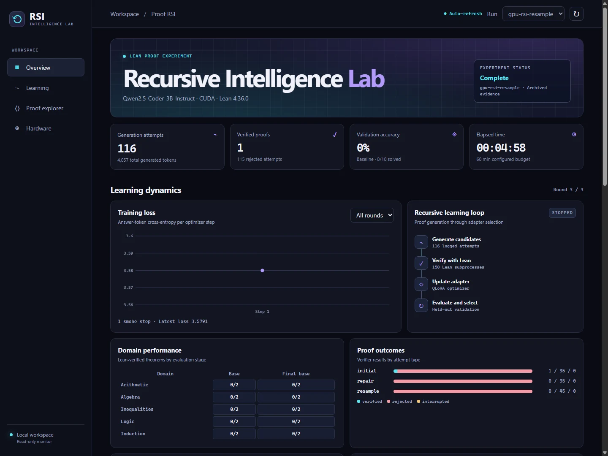
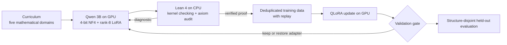
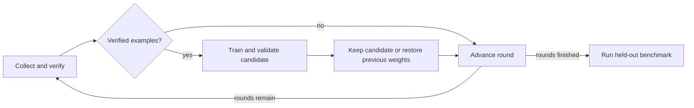
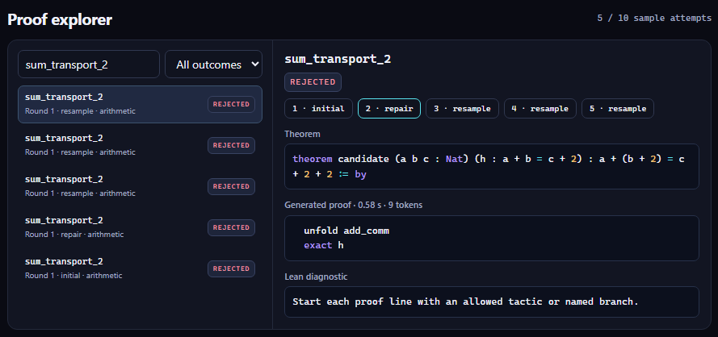
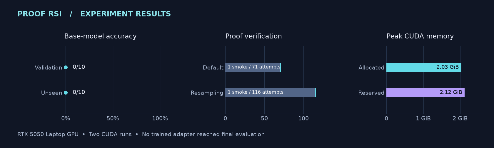

# Proof RSI — Recursive Self-Improvement

Proof RSI is a GPU-tested framework for turning model-generated Lean 4 proofs into verified QLoRA training data. It combines 4-bit Qwen2.5-Coder-3B-Instruct inference, diagnostic-guided proof repair, and validation-gated adapter selection on a consumer GPU.

[](assets/dashboard.webp)

*The research dashboard tracks Lean proof verification, recursive learning rounds, and live GPU telemetry. This preview shows a recorded CUDA run in archive mode.*

## Key engineering achievements

| Milestone | Validated result |
|---|---|
| GPU inference | 4-bit NF4 Qwen inference on an RTX 5050 Laptop GPU |
| Formal proof generation | Model-generated proof accepted by Lean 4 in each smoke test |
| QLoRA optimizer | Rank-8 adapter weights changed in each smoke test |
| Trainable parameters | **3,022,848 (0.098%)** of base plus adapter |
| Peak CUDA allocation | **2.03 GiB** per run |
| Experiment throughput | **187 proof attempts** and **6,841 generated tokens** across two runs |
| Adaptive curriculum | **3/3 proof-collection rounds** per run across five mathematical domains |

## System architecture

Conceptual diagram of the CPU/GPU data flow.



**GPU memory.** The frozen backbone uses 4-bit NF4 with double quantization. Rank-8 adapters target attention query, value, and output projections. Gradient checkpointing and projection of only the logits needed for answer loss reduce training memory. Parameter counts use checkpoint tensor shapes and count the tied base embedding once.

**Stack.** PyTorch CUDA, Transformers, bitsandbytes, PEFT, and Lean 4. The dashboard uses browser-native HTML, CSS, and JavaScript with a Python standard-library server.

## Recursive learning methodology

Conceptual round lifecycle with validation-gated adapter selection.



1. Measure the frozen model on the validation bank. Generate proofs over a five-domain curriculum with adaptive difficulty. A failed candidate can receive Lean diagnostics for repair, followed by sampled retries.
2. Admit only Lean-verified continuations to the training pool. Apply answer-token cross-entropy on new proofs and a subset of replay examples. Later rounds can also attempt conjectures constructed from a bounded Nat expression grammar.
3. Retain an adapter when complete validation matches or exceeds the best score. Restore prior weights after a lower or incomplete result. Evaluate the original and selected models on a separate theorem bank with matched decoding budgets when an adapter is available.

**Formal verification.** The verifier checks each candidate in a fresh Lean process using core Lean, a restricted tactic grammar, and time, memory, and heartbeat limits. It audits `#print axioms` and permits only `propext`, `Classical.choice`, and `Quot.sound`. Hand-authored reference proofs are verification fixtures. Model prompts receive theorem statements and, when repairing, the failed candidate and a bounded diagnostic.

## Interactive research dashboard

- **Proof explorer** shows theorem statements, generated tactics, Lean diagnostics, repair attempts, and the axiom audit for accepted proofs.
- **Learning charts** show proof outcomes, domain accuracy, checkpoint status, and optimizer loss when recorded.
- **GPU monitoring** reports utilization, memory, temperature, power, elapsed time, and token counts during live runs. Archive mode loads bundled results.



[Watch the 5-second proof explorer demo](assets/proof-explorer-demo.gif). It steps through a failed attempt and repair, then filters to the verified smoke proof and its axiom audit.

## Experimental evidence



| Metric | Default CUDA run | CUDA run with resampling |
|---|---:|---:|
| Base validation accuracy | 0/10 | 0/10 |
| Base accuracy on unseen theorem structures | 0/10 | 0/10 |
| Lean-verified smoke proofs | 1 | 1 |
| Diagnostic-guided repairs verified | 0/35 | 0/35 |
| Verified curriculum proofs | 0 | 0 |
| Recursive training rounds completed | 0 | 0 |
| Selected adapter held-out accuracy | Unavailable | Unavailable |
| Logged attempts / generated tokens | 71 / 2,784 | 116 / 4,057 |
| Peak PyTorch CUDA allocation | 2,081.9 MiB | 2,081.9 MiB |
| Elapsed runtime | 232.14 s | 298.84 s |

Both smoke tests verified `exact rfl` and recorded a loss of **3.5791** on the optimizer step. The runner restored the initial adapter weights before baseline evaluation. The recorded runs establish smoke-test functionality. Reasoning improvement remains unmeasured. [Run metrics and proof samples](results/README.md)

The benchmark uses small, hand-authored theorem banks. The resampling run recorded 70 syntax-gate rejections and 45 Lean rejections. A more gradual curriculum and tighter Lean 4 prompting are candidates for improving proof collection. A larger held-out bank and a matched training control would support future gain estimates.

## Quick start and reproducibility

Use Linux or WSL2, Python 3.12, and a CUDA-capable NVIDIA GPU for model execution. The recorded hardware was an RTX 5050 Laptop GPU. Run these commands from the repository root.

```bash
python3.12 -m venv .venv
source .venv/bin/activate
python -m pip install torch==2.8.0 --index-url https://download.pytorch.org/whl/cu128
python -m pip install -r requirements.txt
```

Install Elan with the official CLI setup, then install the toolchain pinned in [lean-toolchain](lean-toolchain). The project uses the core Lean library. [Lean manual installation](https://lean-lang.org/install/manual/)

```bash
elan toolchain install "$(cat lean-toolchain)"
lean --version
python -B -m unittest discover -s tests -v
```

Download the model revision used in the experiment, subject to the upstream license. The runner loads weights locally and accepts `--model PATH` for an existing copy. [Model card](https://huggingface.co/Qwen/Qwen2.5-Coder-3B-Instruct) · [Qwen Research License](https://huggingface.co/Qwen/Qwen2.5-Coder-3B-Instruct/blob/488639f1ff808d1d3d0ba301aef8c11461451ec5/LICENSE)

```bash
hf download Qwen/Qwen2.5-Coder-3B-Instruct \
  --revision 488639f1ff808d1d3d0ba301aef8c11461451ec5 \
  --local-dir models/Qwen2.5-Coder-3B-Instruct
```

Run the GPU smoke test first. It requires a newly generated proof to pass Lean and checks that one optimizer step changes the adapter weights. Use a fresh output directory for each invocation.

```bash
CUDA_VISIBLE_DEVICES=0 python -u rsi.py run --device cuda --out runs/smoke --smoke-only
```

Run the full three-round, 60-minute-budget protocol with the resampling configuration used in the second recorded run.

```bash
CUDA_VISIBLE_DEVICES=0 python -u rsi.py run --device cuda --out runs/reproduction \
  --minutes 60 --rounds 3 --attempts 5
```

Open the dashboard at [http://localhost:8765](http://localhost:8765). The first command reads `runs/` and refreshes every four seconds. The second opens the bundled evidence with representative proof attempts and full recorded totals.

```bash
python -B dashboard/server.py
```

```bash
python -B dashboard/server.py --runs-dir results --no-telemetry
```

## Repository structure

```text
rsi.py                 Experiment runner, evaluation, plots, and chat
engine.py              Local Qwen inference and QLoRA
verifier.py            Lean process isolation, syntax gate, and axiom audit
curriculum.py          Training and validation banks, bounded conjectures
final_bank.py          Held-out theorem bank
dashboard/             Read-only live and archived run explorer
results/               Measured metrics, proof samples, and smoke proofs
examples/              Minimal standalone verifier dataset
tests/                 CPU-only Lean and evidence checks
assets/                README visualizations
```

## Licensing

MIT is recommended for the original project code, subject to approval by its copyright holder. The upstream model has separate research-license terms. Dependencies keep their respective licenses. Model weights and adapter binaries are excluded from this repository. [MIT license guidance](https://choosealicense.com/licenses/mit/) · [Qwen Research License](https://huggingface.co/Qwen/Qwen2.5-Coder-3B-Instruct/blob/488639f1ff808d1d3d0ba301aef8c11461451ec5/LICENSE)
